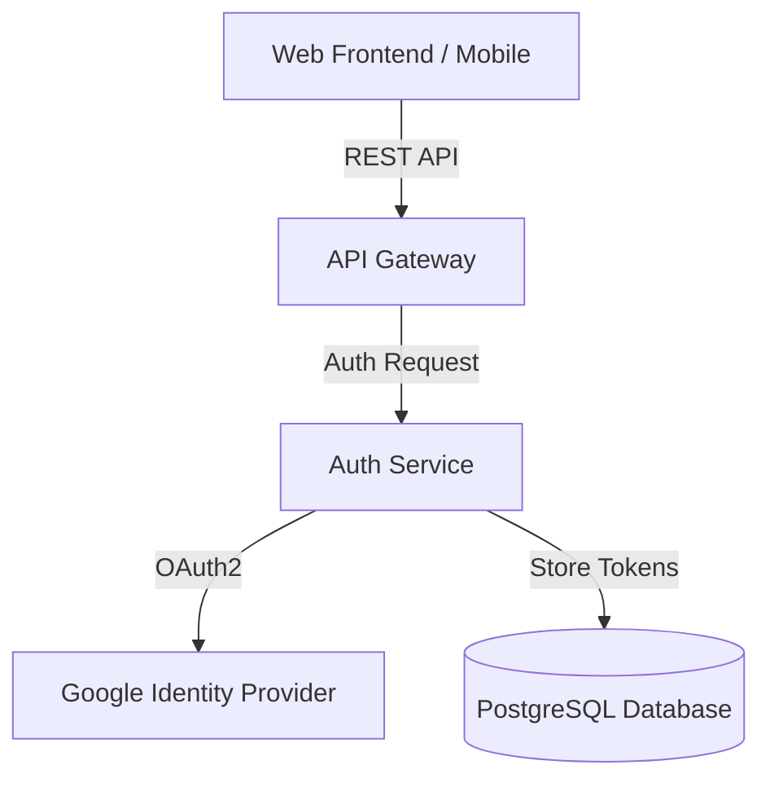

# Solution Architecture: [Назва Фічі]

## 1. Component Impact & Topology
*Опис компонентів системи, які зазнають змін:*

## 2. Architecture Decision Records (ADR)
**ADR-001: [Назва рішення, наприклад: Використання бібліотеки Google Auth Library]**

- **Status**: [Proposed | Accepted | Rejected]
- **Context**: Потрібно реалізувати перевірку Google ID Token на бекенді.
- **Decision**: Використовувати офіційний SDK `google-auth-library` замість власної реалізації перевірки підпису.
- **Consequences**:
  - Плюси: Автоматична обробка ротації ключів Google, готова безпека.
  - Мінуси: Додаткова залежність у `package.json`.

## 3. Security & Error Handling Strategy

- **Error Format**: Всі помилки повертаються у стандарті RFC 7807 (`application/problem+json`).
- **Logging**: Маскування персональних даних (PII) у логах (email, токени).
