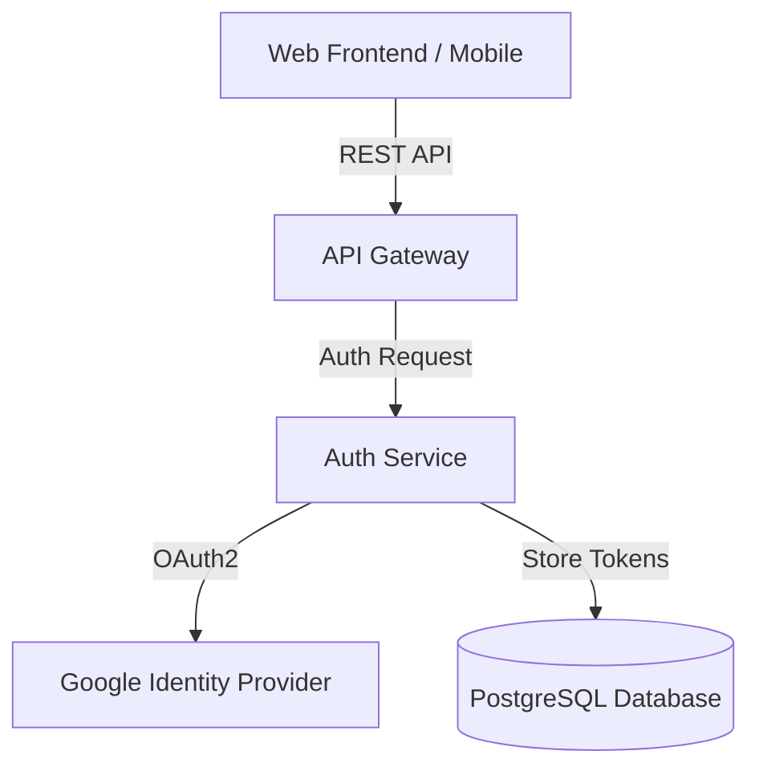

# Solution Architecture: [Feature Name]

## 1. Component Impact & Topology
*Description of the system components affected:*

## 2. Architecture Decision Records (ADR)
**ADR-001: [Decision name, e.g. Use of the Google Auth Library]**

- **Status**: [Proposed | Accepted | Rejected]
- **Context**: Need to validate a Google ID token on the backend.
- **Decision**: Use the official `google-auth-library` SDK instead of a custom signature-verification implementation.
- **Consequences**:
  - Pros: Automatic handling of Google key rotation, ready-made security.
  - Cons: Extra dependency in `package.json`.

## 3. Security & Error Handling Strategy

- **Error Format**: All errors are returned in RFC 7807 format (`application/problem+json`).
- **Logging**: Personal data (PII) masked in logs (email, tokens).
